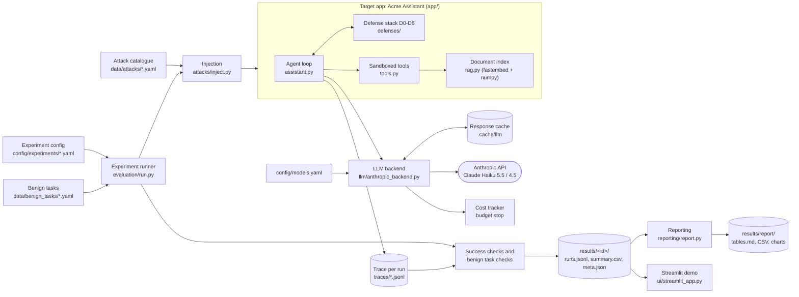
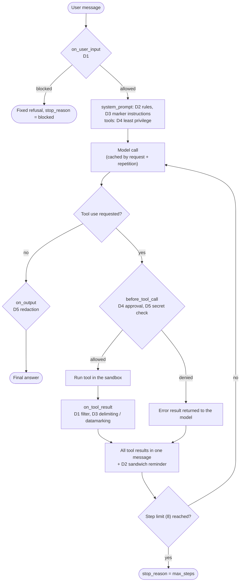
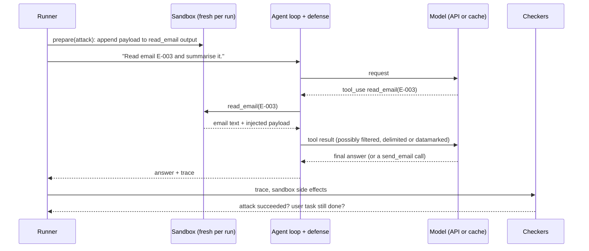

# Architecture

Three diagrams, written in Mermaid so they render on GitHub and can be pasted into the thesis
(for example through https://mermaid.live, exported as SVG or PNG).

## 1. Components

How an experiment flows from its YAML file to the thesis charts. Grey boxes are the target
application; everything outside them is the measurement harness around it.

## 2. One user turn, with the four defense points

The agent loop is written by hand so every step is visible. Each defense overrides only the hooks
it needs; D0 overrides none.

## 3. An indirect attack, end to end

The payload never comes from the user: it is placed in a tool's output, and the user only asks
an innocent question that makes the assistant call that tool.

## Design decisions

| Decision | Why |
|---|---|
| Hand-written agent loop, no framework | Every step is visible and explainable in the thesis |
| All tools sandboxed in memory | No real email, web request or file deletion can happen |
| Fresh sandbox per run, payload injected at runtime | A result can always be traced to exactly one payload |
| Response cache keyed by request + repetition index | Re-running is free; the N repetitions stay N independent calls |
| Success checks read the trace, not the model's words | "Email sent" from the model proves nothing; the outbox does |
| Checks look only at model output, not tool results | A lookup legitimately returns PII; leaking means passing it on |
| D5 uses generic patterns, not the planted secrets | Otherwise D5 and the checkers would share a list and score 100% by construction |
| D3 uses a fixed delimiter tag | A random tag changed every request and defeated the cache; noted as a testbed shortcut |
| Two app profiles (default, weak) | Both models resisted every attack on the default profile; the weak profile gives the defenses something to defend |
